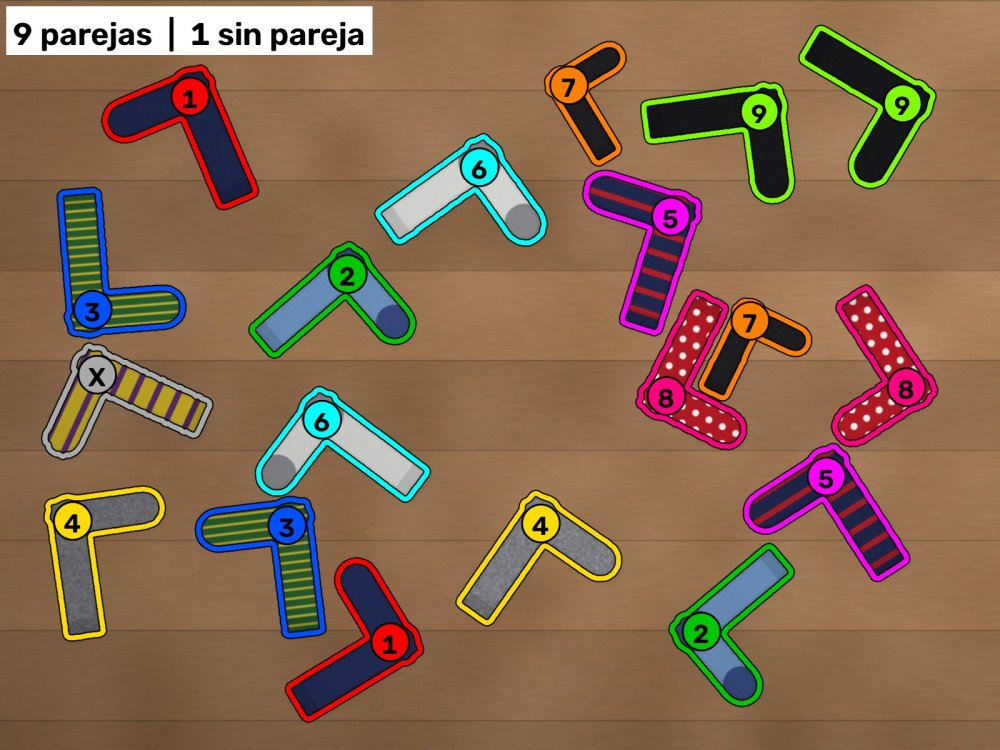

# Calcetines — emparejador de calcetines

App Android que, a partir de una foto de calcetines desparejados, rodea cada pareja con el mismo color y un número. Los calcetines sin pareja salen en gris con una ✕.



## Descargar la app

Cada vez que se sube un cambio a `main`, GitHub compila el APK solo. Lo encontrarás en la sección **Releases** de este repositorio. Descarga el `.apk` desde el móvil e instálalo; si Android lo pide, permite instalar apps de ese origen.

## Cómo hacer la foto

- Calcetines **extendidos** por el suelo. Pueden tocarse, pero que no se monten unos encima de otros.
- **Fondo liso**: suelo, manta o sábana.
- **Desde arriba**, con todos dentro y buena luz.

## Qué hace

- Hace la foto con la cámara o la coge de la galería. Todo se procesa en el móvil, sin conexión (unos 10-25 s; la primera vez algo más porque carga los modelos).
- **SlimSAM** (modelo de segmentación) recorta cada calcetín por separado, aunque estén arrugados o se toquen.
- **DINOv2** (modelo de visión) saca la huella de cada trozo del dibujo del calcetín. Para comparar dos calcetines se miran los 20 trozos más distintivos (logos, rayas, tramas) frente al resto de calcetines de la foto, así que cuenta el dibujo y no la forma con la que ha caído.
- Dos calcetines son pareja si cada uno es el más parecido del otro y el parecido supera el umbral. Si no hay ninguno claro, se quedan sin pareja (**✕**); las parejas justas llevan **?**.
- Si el motor de IA no puede arrancar, la app usa el motor básico anterior (colores y formas) y lo indica.
- **Exigencia** (Estricta / Normal / Flexible): cuánto se tienen que parecer dos calcetines para emparejarlos.
- **Corregir**: toca un calcetín y luego su pareja; o selecciónalo y pulsa **Separar**.
- Toca un calcetín para ver solo su pareja. Zoom con pellizco o doble toque.
- Compartir la imagen con el resultado.
- Avisa cuando hay una versión nueva en Releases y la instala desde la propia app.

## Estructura

- `app/src/main/assets/motor-ia.js`: el motor con IA (SlimSAM + DINOv2 con onnxruntime-web).
- `app/src/main/assets/emparejador.js`: el motor básico (separa suelo y objetos; también es el respaldo).
- Los modelos (`assets/modelos/`) y onnxruntime-web (`assets/ort/`) no están en el repositorio: el flujo de compilación los descarga y comprueba su huella SHA-256.
- `app/src/main/assets/index.html`: la interfaz.
- `app/src/main/java/es/pablo/calcetines/MainActivity.java`: la ventana Android (cámara, galería, compartir y actualizaciones).
- `.github/workflows/compilar-apk.yml`: compila y publica el APK.
- `herramientas/`: banco de pruebas con fotos sintéticas.
- `prototipo-python/`: el prototipo original en Python/OpenCV.

## Banco de pruebas (motor básico)

Para medir el acierto del motor básico con fotos sintéticas:

```
pip install opencv-python numpy
python herramientas/preparar_banco.py
node herramientas/banco-pruebas.js
```

Genera fotos sintéticas (fondo de madera y sábana beige) con parejas conocidas y un calcetín huérfano, y comprueba cuántas parejas acierta. El motor con IA se ha ajustado con fotos reales.

## Actualizaciones

La app comprueba al abrirse si hay una versión nueva en Releases. Para que funcione, el repositorio tiene que ser público.

La clave de firma (`app/calcetines.jks`) está en el repositorio para que cada versión se pueda instalar encima de la anterior.

## Modelos y licencias

- SlimSAM (`Xenova/slimsam-77-uniform`), derivado de Segment Anything (Apache 2.0).
- DINOv2 small (`Xenova/dinov2-small`), de Meta (Apache 2.0).
- onnxruntime-web, de Microsoft (MIT).
